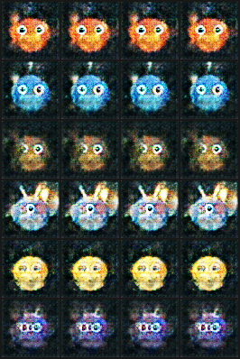
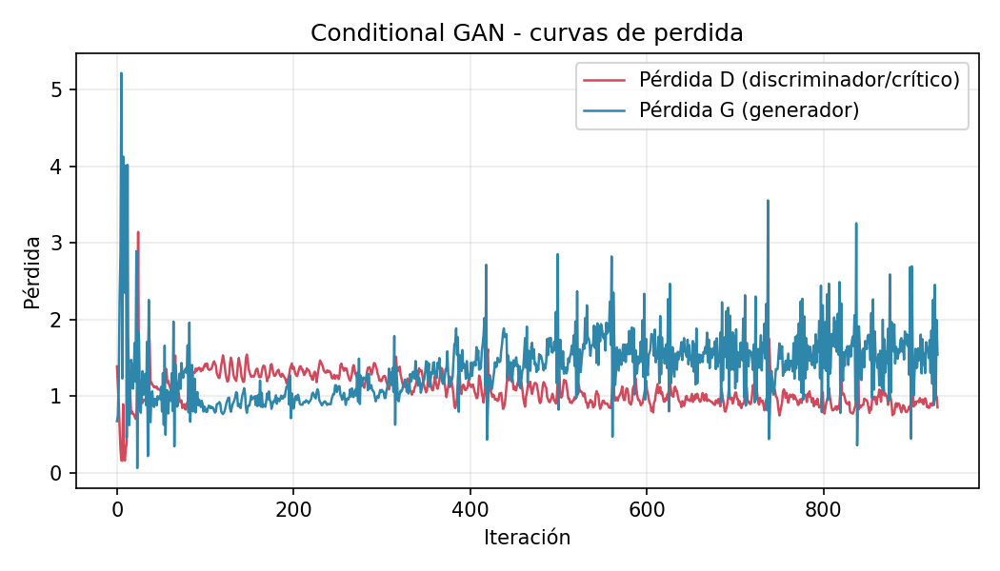

# Glimmerfen en producción — Generador de personajes (GAN)

**Curso:** Deep Learning y Sistemas Inteligentes, Universidad del Valle, 2026
**Equipo:** Cindy Gualim y Gadiel Ocaña *(dupla — ver nota en "Planificación")*
**Modelo base:** [Proyecto 2 — Diseño generativo de personajes: Glimmerfen](https://github.com/GAOV314/Proyecto2_deepLearning_GAN)

> **Estado de este repositorio:** Fase 1 (servicio en producción) y Fase 2
> (mejora: Conditional GAN) están **implementadas, entrenadas y validadas**.
> El servicio ya sirve el modelo condicional. Pendiente: desplegarlo en
> Render y capturar las evidencias de uso real (sección 7).

## 1. Problemática

**Usuario:** un estudio indie (o un creador individual) que está diseñando
nuevas criaturas para un juego o cómic de fantasía.

**Problema:** bocetar variantes de personajes a mano, una por una, es lento
y costoso en la fase temprana de ideación — antes de saber siquiera si un
diseño vale la pena pulirlo.

**Decisión que depende del modelo:** qué bocetos generados (y de qué
elemento: fuego, agua, tierra, aire, luz o sombra) pasan de "candidato
generado" a "encargo de arte final a un ilustrador humano". El modelo acelera
el embudo creativo — no reemplaza al ilustrador, filtra en qué conviene
invertir su tiempo.

## 2. Planificación

| Etapa | Detalle | Responsable | Fecha objetivo |
|---|---|---|---|
| Empaquetar modelo entrenado | Copiar `ganverse` (inferencia) + checkpoint ganador del Proyecto 2, validar carga y generación | Gadiel | ✅ Listo |
| Servicio web (Fase 1 — MVP) | App Gradio (`app.py`) que genera un personaje por semilla, validada localmente (carga de pesos, forward, servidor ASGI) | Gadiel | ✅ Listo |
| Mejora del modelo (Fase 2) | Conditional GAN: condicionar el Generador/Discriminador al elemento para poder *pedir* un elemento específico. Entrenada (30 épocas) | Gadiel | ✅ Listo |
| Validación de la mejora | Hipótesis + métrica + criterio de éxito definidos antes de entrenar, resultado medido (sección 5) | Gadiel | ✅ Listo |
| Servicio actualizado | `app.py` sirve el modelo condicional con selector de elemento | Gadiel | ✅ Listo |
| Despliegue público | Publicar en Render (gratis, CPU, link público; HF Spaces dejó de ser gratis para Gradio) | Cindy | 9 nov |
| Evidencias de producción | Capturas, enlace, prueba de uso por alguien ajeno al equipo | Cindy y Gadiel | 9-13 nov |
| Presentación | Slides (adaptadas de `presentacion.pdf` del Proyecto 2) + ensayo | Ambos | 8 nov |

**Nota sobre la modalidad:** el enunciado pide tríos; este equipo es una
dupla (mismo equipo del Proyecto 2 de origen). Pendiente de confirmar con el
docente si se mantiene como dupla o se incorpora un tercer integrante.

## 3. Supuestos

- **Sobre los datos:** el dataset es procedural (generado por código propio
  con PIL, `ganverse/dataset.py`), no contiene arte de terceros ni rostros
  reales — se asume que esto es aceptable como sustituto de un dataset real
  de concept art para efectos de este curso.
- **Sobre el usuario:** se asume que el usuario del servicio no necesita
  control fino sobre la pose o el detalle del personaje en esta primera
  versión — solo diversidad y, con la mejora de Fase 2, control del elemento.
- **Sobre el entorno:** el servicio corre en CPU (no se asume GPU disponible
  en producción) porque el Generador es pequeño (~25MB, DCGAN de 5 capas) y
  una sola imagen de 64×64 se genera en milisegundos en CPU.

## 4. Modelo planteado

**Proyecto de origen:** [GAOV314/Proyecto2_deepLearning_GAN](https://github.com/GAOV314/Proyecto2_deepLearning_GAN)
— una DCGAN (Radford et al., 2015) con dos variantes experimentales
(WGAN-GP y normalización espectral), documentadas y comparadas en
`PROJECT.md` de ese repositorio.

**Arquitectura reusada:** `Generator` toma un vector latente `z` (dim 100) y
produce una imagen 64×64×3 mediante 5 capas `ConvTranspose2d` con BatchNorm +
ReLU y `Tanh` final. Se usa el checkpoint de la variante
**`stab_spectral_norm`** (normalización espectral en el Discriminador en vez
de BatchNorm), identificada en el proyecto de origen como la más estable de
las tres (ver `PROJECT.md` sección 5 del repo de origen).

**Cambio implementado para el Proyecto Final — Conditional GAN (Fase 2):**
El Generador y Discriminador originales son *incondicionales*: cada imagen
sale de ruido puro, sin forma de pedir un elemento específico. Para que la
decisión de negocio (sección 1: "¿qué elemento encargar?") sea realmente
accionable por el usuario, se condicionó ambas redes a la etiqueta de
elemento (6 clases, ya definidas en `dataset.py` pero antes no persistidas):

- `ConditionalGenerator` (`src/ganverse/models.py`): se concatena un
  embedding (`nn.Embedding`) del elemento al vector `z` antes de la primera
  `ConvTranspose2d`.
- `ConditionalDiscriminator`: se proyecta el embedding del elemento a un
  mapa espacial de 64×64 y se concatena como canal extra a la imagen de
  entrada (enfoque estándar de cGAN condicional por canal, Mirza &
  Osindero 2014), manteniendo la normalización espectral (la variante más
  estable del Proyecto 2).
- El dataset se regeneró con la misma semilla (42) — exactamente las mismas
  4000 imágenes del Proyecto 2 — agregando `labels_elemento.npy`, la
  etiqueta que antes se descartaba (`ganverse/dataset.py::save_dataset`).
- Entrenamiento: 30 épocas, misma receta de pérdida (BCE no saturante) y
  optimizador (Adam 2e-4, β=(0.5, 0.999)) que `stab_spectral_norm`
  (`scripts/train_conditional.py`, checkpoint en `experiments/conditional/`).

## 5. Validación de hipótesis

**Ya validado en el proyecto de origen** (reusado, ver `PROJECT.md` del repo
base secciones 4-7): comparación baseline (BCE) vs. WGAN-GP vs. normalización
espectral, con hipótesis y criterio de éxito definidos antes de entrenar
cada corrida, evaluados con curvas de pérdida, rejilla de ruido fijo
compartida y prueba de vecinos más cercanos (para descartar memorización).
Resultado: `stab_spectral_norm` fue la corrida más estable, por eso es la
que se sirve en producción.

**Hipótesis nueva para la mejora de Fase 2 (Conditional GAN):**

- **Hipótesis:** condicionar la GAN al elemento permite pedir un elemento
  específico sin perder la diversidad visual lograda en el Proyecto 2.
- **Métrica:** tasa de acierto de elemento — de N personajes generados
  pidiendo el elemento X, qué porcentaje tiene el elemento X como dominante
  según el clasificador de color ya existente (`gallery._dominant_element`,
  reusado como evaluador automático externo, no como parte del modelo).
- **Criterio de éxito (definido antes de entrenar):** ≥80% de acierto por
  elemento solicitado.
- **Línea base:** el modelo incondicional (`stab_spectral_norm`), que al no
  poder elegir elemento, produce cada elemento con una frecuencia natural
  de ~16.7% si se le pide uno y se acepta la primera muestra (medido
  empíricamente: 9.5%–27.0% según el elemento, promedio 16.7%).

**Resultado (`scripts/evaluate_conditional.py`, `experiments/conditional/evaluation.json`,
100 muestras por elemento, semilla 123):**

| Elemento | Acierto condicional | Frecuencia natural (línea base) |
|---|---|---|
| fuego  | 100% | 15.7% |
| agua   | 100% | 9.5%  |
| tierra | 100% | 27.0% |
| aire   | 100% | 18.8% |
| luz    | 100% | 13.8% |
| sombra | 100% | 15.2% |
| **Promedio** | **100%** | **16.7%** |

**Hipótesis confirmada y criterio de éxito superado** (100% ≫ 80%). La
inspección visual confirma que el color/elemento de cada fila es
consistente con la etiqueta pedida (filas, de arriba a abajo: fuego, agua,
tierra, aire, luz, sombra; 4 muestras por fila, semilla 999):



**Limitación honesta detectada (no estaba en el criterio de éxito original,
se midió de todas formas por rigor):** la diversidad *dentro* de cada
elemento bajó mucho frente al modelo incondicional. Distancia media por
pares (MSE de píxeles, 30 muestras/elemento, `experiments/conditional/
diversity_check.json`): el modelo condicional obtiene ~12–23, frente a
~1600–2700 en el incondicional agrupado por el mismo clasificador — un
orden de magnitud menos variado en pose/forma dentro de cada elemento
(aunque sí varía el color exacto y pequeños detalles). Es decir: la mejora
ganó control total del elemento a costa de diversidad intra-clase, un
trade-off real que no se buscaba explícitamente pero que es importante
declarar (igual que el Proyecto 2 documentó honestamente las limitaciones
de WGAN-GP en vez de ocultarlas). Mitigarlo (p. ej. con menor peso del
embedding, *minibatch discrimination*, o más épocas) queda como trabajo
futuro fuera del alcance de este curso.

**Curvas de pérdida** (`figures/loss_curve_conditional.png`, últimas 186
iteraciones de 930 — el 20% final): D converge a 0.94 ± 0.11 y G a
1.58 ± 0.39, ninguna colapsa a 0 ni diverge — señal de entrenamiento
adversarial saludable, sin el discriminador "ganando" por completo:



## 6. Herramientas y arquitectura

```
┌─────────────┐      offline, una vez       ┌──────────────────────────┐
│  Dataset     │ ───────────────────────────▶│  Entrenamiento GAN        │
│  procedural  │   con labels_elemento.npy    │  condicional (Fase 2)     │
│  + etiqueta  │   (ganverse/dataset.py)      │  (train_conditional.py)   │
└─────────────┘                               └────────────┬─────────────┘
                                                            │ checkpoint.pt
                                                            ▼
                                               ┌──────────────────────────┐
                                               │  experiments/conditional/ │
                                               │  ConditionalGenerator      │
                                               └────────────┬─────────────┘
                                                            │ se carga 1 vez
                                                            ▼
┌─────────────┐   HTTP (navegador)    ┌──────────────────────────────────┐
│  Usuario     │◀──────────────────── │  app.py — Gradio (CPU)             │
│  (ajeno al   │ ────────────────────▶│  elige elemento + semilla          │
│  equipo)     │  pide personaje       │  ConditionalGenerator(z, label)     │
└─────────────┘                       │  servido en Render (free web service)│
                                       └──────────────────────────────────┘
```

- **Datos y entrenamiento:** PyTorch, offline, en el repositorio de origen
  (no se reentrena en producción).
- **Servicio:** Gradio 4.44 sobre FastAPI/uvicorn, CPU-only (`DEVICE =
  torch.device("cpu")` en `app.py`), sin dependencia de GPU.
- **Despliegue:** [Render](https://render.com) (free web service), desplegado
  directo desde este repositorio de GitHub (`render.yaml`); expone tanto la
  interfaz web como una API programática vía `gradio_client`. Se evaluó
  Hugging Face Spaces primero, pero HF dejó de ofrecer Spaces de Gradio/Docker
  gratis (ahora requieren suscripción PRO) — Render sí tiene un tier gratuito
  real para este tipo de servicio.
- **Monitoreo (mínimo, dado el alcance del curso):** logs de acceso propios
  de Render (requests, errores, tiempo de respuesta) + captura manual de uso
  real como evidencia (sección 7). Nota: en el plan gratis el servicio
  "duerme" tras 15 min sin tráfico y tarda ~30-60s en despertar en la
  siguiente visita — aceptable para una demo del curso.

## 7. Evidencias del pase a producción

*(pendiente de completar tras el despliegue — checklist:)*

- [ ] Enlace público al servicio en Render.
- [ ] Captura de pantalla generando un personaje desde el navegador.
- [ ] Registro de uso (logs de Spaces o capturas de requests).
- [ ] Prueba hecha por alguien ajeno al equipo (compañero, familiar) con
      captura o testimonio corto.

## Instalación y ejecución local

```bash
python3 -m venv .venv && source .venv/bin/activate
pip install -r requirements.txt
python app.py
```

Abre `http://127.0.0.1:7860`. El servicio carga automáticamente
`experiments/conditional/checkpoint.pt` (Conditional GAN, Fase 2, ~27MB); si
no existiera, cae de vuelta a `checkpoints/stab_spectral_norm.pt` (Fase 1).
No requiere GPU.

Para reentrenar desde cero (opcional, no es necesario — el checkpoint ya
está incluido):

```bash
PYTHONPATH=src python -c "from ganverse.dataset import save_dataset; save_dataset(n=4000, out_dir='data/glimmerfen', seed=42)"
PYTHONPATH=src python scripts/train_conditional.py        # ~5 min en Apple Silicon (MPS)
PYTHONPATH=src python scripts/evaluate_conditional.py     # reproduce los resultados de la sección 5
```

## Estructura del repositorio

```
├── app.py                        # Servicio de producción (Gradio, modelo condicional)
├── requirements.txt
├── checkpoints/
│   └── stab_spectral_norm.pt     # Pesos del Generador incondicional (Proyecto 2, Fase 1)
├── experiments/conditional/
│   ├── checkpoint.pt              # Pesos de la Conditional GAN (Fase 2, el que sirve app.py)
│   ├── loss_history.json
│   ├── evaluation.json            # Resultado de la validación de hipótesis (sección 5)
│   ├── diversity_check.json       # Métrica de diversidad intra-clase (limitación, sección 5)
│   └── snapshots/                 # Evolución del entrenamiento (ruido fijo cada 3 épocas)
├── data/glimmerfen/               # Dataset procedural (.npy) + labels_elemento.npy
├── src/ganverse/                  # Código reusado y extendido del proyecto de origen
│   ├── models.py                  # Generator/Discriminator + ConditionalGenerator/Discriminator
│   ├── dataset.py                 # Generador procedural + etiquetas de elemento
│   ├── losses.py                  # BCE no saturante + WGAN-GP
│   ├── train.py                   # Entrenamiento incondicional (Proyecto 2) y condicional (Fase 2)
│   ├── gallery.py                 # Selección/clasificación por elemento (reusado en evaluación)
│   ├── evidence.py
│   └── utils.py
├── scripts/
│   ├── train_conditional.py       # Entrena la Conditional GAN
│   └── evaluate_conditional.py    # Valida la hipótesis de la sección 5
├── figures/                       # Evidencia heredada del Proyecto 2 + rejilla condicional
├── tests/                         # Pruebas unitarias (pytest, incluye modelos condicionales)
└── Proyecto_Final_Modelo_en_Produccion.pdf   # Enunciado del curso
```

## Uso de inteligencia artificial

Se utilizó **Claude (Anthropic, Claude Code)** como asistente para: evaluar
cómo adaptar el Proyecto 2 (GAN) a los requisitos del Proyecto Final, armar
el servicio de producción (`app.py`), diseñar e implementar la Conditional
GAN de la Fase 2 (`ConditionalGenerator`/`ConditionalDiscriminator`,
persistencia de etiquetas en `dataset.py`, `train_conditional`), entrenarla,
construir y correr el script de validación de hipótesis
(`evaluate_conditional.py`) y el chequeo de diversidad, diagnosticar y fijar
incompatibilidades de dependencias (`gradio`/`pydantic`/`huggingface_hub` y
el operador `vdot` de normalización espectral en MPS), y redactar este
README. El código base (`src/ganverse/` original) proviene del Proyecto 2,
donde también se usó Claude como asistente (declarado en el README de ese
repositorio). El equipo es responsable de explicar cualquier parte del
código y de las decisiones reportadas aquí.

## Licencia de los datos

El dataset es generado por código propio (`ganverse/dataset.py`), no
proviene de internet ni contiene rostros reales ni personajes de terceros.
Es propiedad del equipo (CC0 / material original para este curso).
